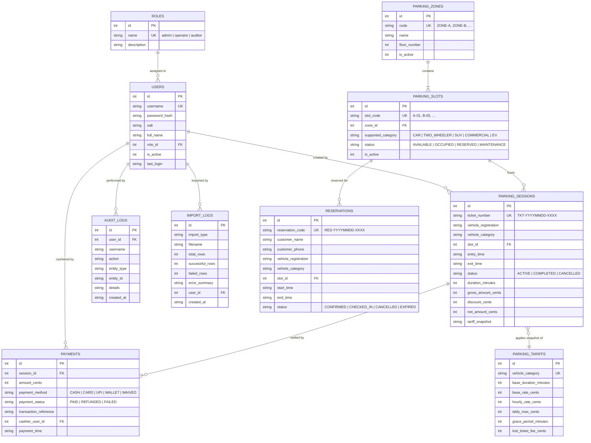

# ParkSmart Pro — Database Architecture & Schema Specification
**Subject:** Total Quality Management (TQM) — Database Optimization  
**Engine:** SQLite 3 with WAL Mode, Foreign Keys Enforced, and Partial B-Tree Indexes  

---

## 1. Entity-Relationship (ER) Diagram



---

## 2. Key Architectural Invariants & Constraints

### 1. Integer Minor Currency Representation
Floating-point arithmetic in software introduces precision errors (e.g. `0.1 + 0.2 = 0.30000000000000004`). In financial systems, this leads to penny rounding discrepancies.  
**ParkSmart Pro stores all currency as integer minor units (cents/paise):**
- `$25.50` is stored as integer `2550`.
- All multiplications and discounts use exact integer division with `round()`.

### 2. Double-Allocation Prevention (Partial Unique Index)
Standard table-level unique constraints cannot handle active vs historical status. ParkSmart Pro uses SQLite's **Partial Unique Index**:
```sql
CREATE UNIQUE INDEX idx_unique_active_slot_alloc 
    ON parking_sessions (slot_id) 
    WHERE status = 'ACTIVE';
```
*Effect:* Any attempt to assign an active ticket to an already active slot fails immediately at the database engine level, making race conditions impossible.

### 3. Duplicate Active Vehicle Prevention (Partial Unique Index)
```sql
CREATE UNIQUE INDEX idx_unique_active_session 
    ON parking_sessions (vehicle_registration) 
    WHERE status = 'ACTIVE';
```
*Effect:* A vehicle currently parked inside cannot be issued a second active parking ticket until its prior session is completed and paid.

### 4. Tariff Immutability Snapshotting
When a parking session is settled, the active tariff configuration is serialized into `tariff_snapshot` (JSON string). If an administrator later increases parking rates, historical revenue calculations and audit reports remain 100% historically immutable.

---

## 3. High-Performance Indexing Strategy

| Index Name | Target Table | Indexed Columns | Justification / Query Plan Impact |
| :--- | :--- | :--- | :--- |
| `idx_sessions_ticket` | `parking_sessions` | `(ticket_number)` | Enables $O(\log N)$ barcode scanner lookups during vehicle exit. |
| `idx_sessions_reg` | `parking_sessions` | `(vehicle_registration)` | Enables instantaneous search by vehicle license plate. |
| `idx_sessions_status` | `parking_sessions` | `(status)` | Accelerates active vs completed session partitioning. |
| `idx_sessions_entry` | `parking_sessions` | `(entry_time)` | Accelerates date-range reporting and daily inflow charts. |
| `idx_slots_zone_status` | `parking_slots` | `(zone_id, status)` | Powers real-time visual grid and zone occupancy counters. |
| `idx_reservations_overlap`| `reservations` | `(slot_id, status, start_time, end_time)` | Powers conflict detection engine for advance bookings. |
| `idx_audit_created` | `audit_logs` | `(created_at)` | Accelerates chronological audit trail inspection. |
