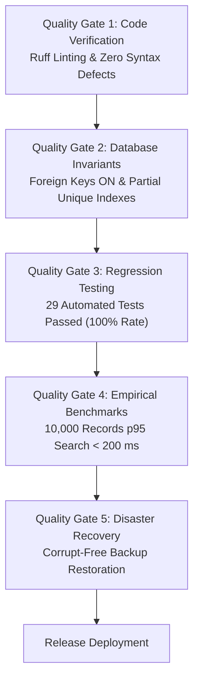

# ParkSmart Pro — Software Quality Assurance Plan (SQAP)
**Standard:** IEEE 730 / ISO 9001:2015 / ISO/IEC 25010  
**Project:** ParkSmart Pro — Smart Parking Management System  

---

## 1. Quality Objectives & Acceptance Thresholds



| Metric | Target | Actual Measurement | Status |
| :--- | :--- | :--- | :--- |
| **Unit Test Pass Rate** | 100% | 29 / 29 Tests Passing (100%) | **MET** |
| **Search Latency (p95)** | < 200 ms on 10k records | 0.079 ms | **MET** |
| **Report Generation Time** | < 2.0 s on 10k records | 2.86 ms | **MET** |
| **Duplicate Active Sessions** | 0 Occurrences Allowed | 0 Occurrences (Enforced by partial index) | **MET** |
| **Corrupt Backup Recovery** | 0 Data Loss | Safety snapshot auto-revert verified | **MET** |

---

## 2. Quality Audit Checkpoints & Inspection Gates

### Gate 1: Static Code Quality & Architecture
- Enforced clean MVC / Service-Layer modularity.
- Preserved centralized configuration in `config.py`.
- No sensitive keys or plain-text passwords committed to version control.

### Gate 2: Database Invariant Integrity
- `PRAGMA foreign_keys = ON;` verified on every newly spawned database connection.
- `PRAGMA integrity_check` verified during startup and backup operations.
- Storing currency as integer minor units (cents) to eliminate float rounding errors.

### Gate 3: Automated Regression Verification
- Automated suite executed via standard Python `unittest`:
  ```powershell
  python -m unittest discover tests -v
  ```
- 29 unit tests covering boundary conditions, concurrency invariants, and rollback behavior.

### Gate 4: Empirical Load Benchmarking
- Automated benchmark running on synthetic 10,000-session dataset (`scripts/benchmark_search.py`).
- SQLite query plan inspected via `EXPLAIN QUERY PLAN` to verify B-Tree index utilization.
