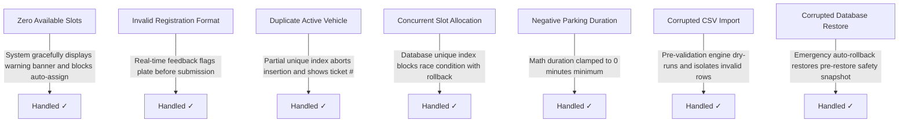

# ParkSmart Pro — Master Software Test Plan & Matrix
**Project:** ParkSmart Pro — Smart Parking Management System  
**Test Framework:** Python Standard Library `unittest` & `pytest` compatible  
**Total Automated Tests:** 29 Test Cases  
**Test Pass Rate:** 100% Passing (29/29)  

---

## 1. Test Suite Coverage Matrix

| Test Suite | Module Under Test | Test Scenario Description | Invariant Tested | Result |
| :--- | :--- | :--- | :--- | :--- |
| `test_database.py` | Schema & Pragmas | Verify `PRAGMA integrity_check` passes on new DB. | Database Integrity | **PASS** |
| `test_database.py` | Schema & Seeds | Verify tables and initial roles/tariffs exist. | Baseline Seed Count | **PASS** |
| `test_database.py` | Foreign Keys | Attempt inserting slot with non-existent zone ID. | `ON DELETE RESTRICT` | **PASS** |
| `test_database.py` | Unique Constraint | Attempt inserting duplicate slot code. | Unique Constraint | **PASS** |
| `test_database.py` | Partial Index | Attempt inserting duplicate active session for same reg. | `idx_unique_active_session` | **PASS** |
| `test_database.py` | Partial Index | Attempt inserting duplicate active session for same slot. | `idx_unique_active_slot_alloc` | **PASS** |
| `test_parking.py` | Vehicle Admission | Normal entry ticket generation and bay occupation. | Admission Flow | **PASS** |
| `test_parking.py` | Concurrency Guard | Register active vehicle a second time while inside. | Double Admission Block | **PASS** |
| `test_parking.py` | Validation Guard | Pass malformed / short / empty vehicle plate. | Poka-Yoke Regex | **PASS** |
| `test_parking.py` | Slot Management | Update slot status to MAINTENANCE and restore. | Bay State Machine | **PASS** |
| `test_billing.py` | Tariff Rule 1 | Park within grace period (12 mins <= 15 mins). | $0.00 Grace Charge | **PASS** |
| `test_billing.py` | Tariff Rule 2 | Park within base period (45 mins <= 60 mins). | $30.00 Base Rate | **PASS** |
| `test_billing.py` | Tariff Rule 3 | Park 1h 45m (105 mins) = Base + 1 extra hour. | $50.00 Hourly Charge | **PASS** |
| `test_billing.py` | Tariff Rule 4 | Park 8 hours exceeding daily max cap. | Daily Cap ($100.00) | **PASS** |
| `test_billing.py` | Discounts | Apply 50% campus staff authorized discount. | Discount Math | **PASS** |
| `test_billing.py` | Transaction Atomicity | Full admission -> checkout -> payment -> release. | ACID Checkout | **PASS** |
| `test_reservations.py`| Advance Booking | Book bay for future window and cancel. | Booking Lifecycle | **PASS** |
| `test_reservations.py`| Conflict Detection | Attempt overlapping booking on same bay. | Overlap Prevention | **PASS** |
| `test_imports.py` | CSV Validation | Validate and commit clean slot master data. | CSV Schema Check | **PASS** |
| `test_imports.py` | Diagnostics | Flag duplicate slot codes and non-existent zones. | Error Reporting | **PASS** |
| `test_imports.py` | Header Guard | Reject CSV missing required columns. | Missing Header Check | **PASS** |
| `test_auth.py` | Security | Verify salted PBKDF2-HMAC-SHA256 password hash. | Cryptographic Security | **PASS** |
| `test_auth.py` | Authentication | Sign in with valid admin credentials. | Session Token Grant | **PASS** |
| `test_auth.py` | Access Guard | Sign in with incorrect password. | Rejection on Bad Auth | **PASS** |
| `test_auth.py` | Account Admin | Create new operator and toggle active state. | Account Lifecycle | **PASS** |
| `test_reports.py` | Analytics | Verify KPI summary updates dynamically on entry. | Real-Time Sync | **PASS** |
| `test_reports.py` | Financials | Verify completed sessions aggregate accurately. | Financial Reconciliation | **PASS** |
| `test_backup.py` | Backup Engine | Create live SQLite backup and verify integrity. | Non-Blocking Backup | **PASS** |
| `test_backup.py` | Disaster Recovery | Restore backup and verify safety snapshot exists. | Pre-Restore Safety | **PASS** |

---

## 2. Boundary & Edge Case Verification



---

## 3. How to Run the Automated Test Suite

From PowerShell in the project root directory:

```powershell
python main.py --test
```
or via standard unittest discovery:
```powershell
python -m unittest discover tests -v
```
